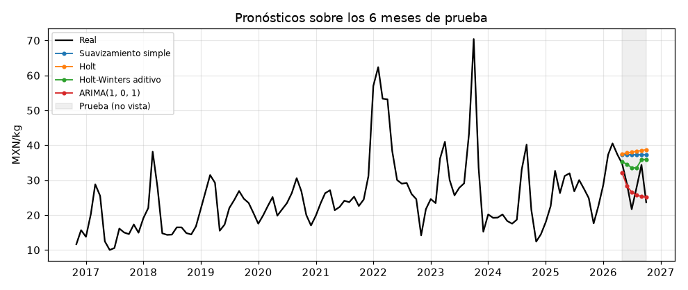
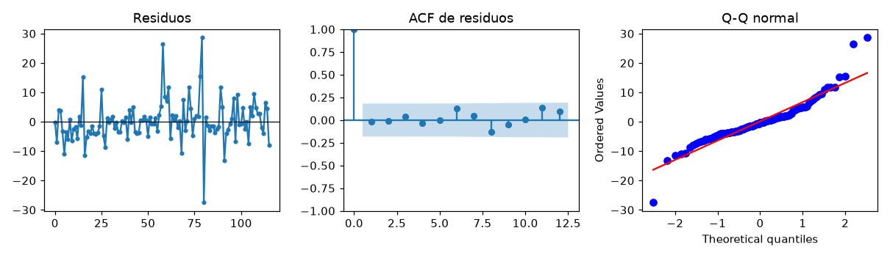
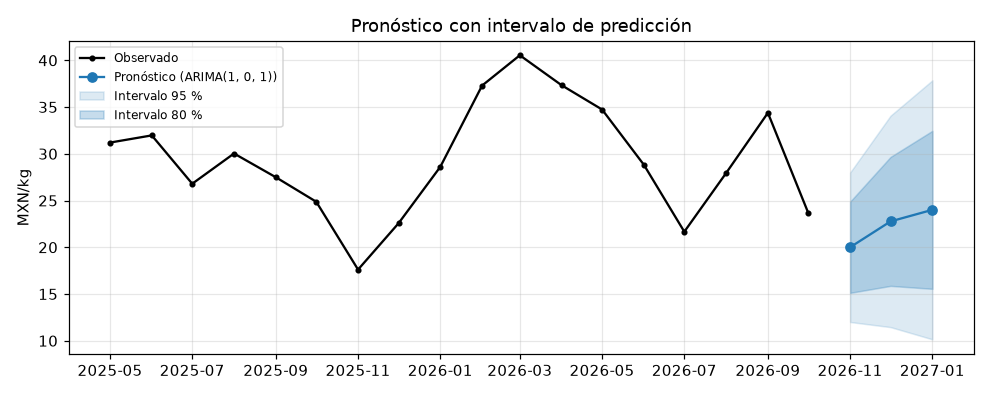

# Laboratorio E1 · Series de tiempo y pronóstico

> Documento **generado** por `python -m laboratorio.e1_series` a partir de `data/oro/panel_mensual.csv`. No editar a mano: las cifras se regeneran. Resultados completos en `laboratorio/resultados/e1/resultados.json`.

**Serie principal:** Limón c/semilla #5 · Colima → Guadalajara, precio frecuente mensual en MXN/kg, 2016-11 a 2026-10 (117 meses, sin imputación). Serie secundaria: Papaya Maradol · Colima → Guadalajara.

## 1. Caracterización

- Nivel: media 25.25 MXN/kg, mediana 23.65, rango 10.00–70.42; coeficiente de variación 40.8 %.
- Tendencia lineal: 0.109 MXN/kg por mes (R² = 0.130, p = 0.0001).
- Estacionalidad: en promedio el mes calendario más caro es el 3 y el más barato el 11 (fuerza estacional 0.12 en escala 0–1).
- Cambio estructural visible: el mayor cambio mensual fue en 2019-03 (87.7 %).
- Ciclos: con 36 meses no se pueden identificar ciclos de más de un año; solo se analiza tendencia y estacionalidad anual.

## 2. Descomposición

Se eligió el modelo **aditivo**. Criterio: preferir el multiplicativo solo si reduce el residuo al menos 5 % o si la dispersión crece claramente con el nivel; si no, el aditivo por parsimonia. El coeficiente de variación del residuo (MXN/kg relativo al nivel) es 0.3033 en el aditivo y 0.3041 en el multiplicativo (mejora -0.2 %); además la correlación entre nivel anual y desviación anual es 0.70 (solo 3 años, evidencia débil).

## 3. Estacionariedad (Dickey-Fuller aumentada y KPSS)

| Serie | ADF | p ADF | KPSS | p KPSS | Conclusión ADF (5 %) |
|---|---|---|---|---|---|
| nivel | -4.2804 | 0.0005 | 0.6299 | 0.0199 | estacionaria |

Orden de diferenciación usado: **d = 0**. KPSS se reporta como contraste (H0 opuesta); su p-valor está acotado entre 0.01 y 0.10 por las tablas de statsmodels.

## 4. Autocorrelación (ACF, PACF) y correlación cruzada

Sobre la serie en nivel (n = 117, banda ±0.181): rezagos significativos en ACF [1, 2, 11] y en PACF [1, 2]. Lectura Box-Jenkins: p ≈ 2, q ≈ 2; la rejilla de AIC explora p, q ∈ {0..3} y un término AR estacional alrededor de esa sugerencia.

- Correlación cruzada (primeras diferencias) con **temperatura media mensual (NOAA, Manzanillo)**: máximo |r| = -0.256 en el rezago 4 (n = 31, banda ±0.352): no significativa al 5 %. Rezago k > 0 significa que la otra variable adelanta al precio del limón en k meses.
- Correlación cruzada (primeras diferencias) con **precio de papaya Maradol (misma plaza)**: máximo |r| = -0.146 en el rezago 0 (n = 116, banda ±0.182): no significativa al 5 %. Rezago k > 0 significa que la otra variable adelanta al precio del limón en k meses.

## 5. Cuatro modelos y selección con datos que no vio

Rejilla ARIMA por AIC sobre el entrenamiento (5 mejores):

| orden | estacional | aic | bic |
|---|---|---|---|
| (1, 0, 1) | (0, 0, 0, 0) | 754.16 | 764.99 |
| (1, 0, 1) | (1, 0, 0, 12) | 755.11 | 768.66 |
| (2, 0, 1) | (0, 0, 0, 0) | 755.96 | 769.51 |
| (1, 0, 2) | (0, 0, 0, 0) | 755.97 | 769.52 |
| (0, 0, 3) | (0, 0, 0, 0) | 756.79 | 770.33 |

Entrenamiento: 2016-11–2026-04 (111 meses). Prueba: 2026-05–2026-10 (6 meses, pronóstico a 1–6 pasos sin reentrenar).

| modelo | MAE | RMSE | MAPE_pct | AIC_entrenamiento |
|---|---|---|---|---|
| ARIMA(1, 0, 1) | 3.464 | 4.469 | 12.079 | 754.156 |
| Holt-Winters aditivo | 6.262 | 7.746 | 25.464 | 797.952 |
| Suavizamiento simple | 8.801 | 10.073 | 34.896 | 782.454 |
| Holt | 9.618 | 10.860 | 37.928 | 786.371 |

**Ganador por menor RMSE (desempate MAPE): ARIMA(1, 0, 1).** Se elige por error fuera de muestra, no por complejidad.

Nota: el tablero del observatorio usa además una validación *walk-forward* a un paso (6 meses de selección + 6 de holdout) en `data/oro/metricas_backtest_colima.csv`; ambos procedimientos son complementarios.

## 6. Residuos del modelo ganador (puerta de calidad 3)

- Ljung-Box (rezago 6: Q = 2.27, p = 0.321; rezago 12: Q = 8.58, p = 0.379): sin autocorrelación.
- Varianza: Levene entre mitades p = 0.011, ARCH-LM p = 0.000 → **no estable**.
- Normalidad (Shapiro-Wilk) p = 0.000 → no normal.
- Decisión: el supuesto no se cumple, así que se publica un **intervalo empírico** construido con los errores observados en la prueba (método que no depende de ese supuesto).

## 7. Pronóstico publicado e interpretación para el cliente

| mes | pronostico | li80 | ls80 | li95 | ls95 | metodo |
|---|---|---|---|---|---|---|
| 2026-11 | 20.00 | 15.13 | 24.88 | 12.01 | 28.00 | empírico (errores de prueba) |
| 2026-12 | 22.77 | 15.87 | 29.67 | 11.46 | 34.08 | empírico (errores de prueba) |
| 2027-01 | 24.01 | 15.56 | 32.46 | 10.15 | 37.86 | empírico (errores de prueba) |

> Para 2026-11 esperamos que el limón c/semilla #5 de Colima se cotice en Guadalajara alrededor de 20.0 MXN/kg; con 80 % de probabilidad estará entre 15.1 y 24.9 y con 95 % entre 12.0 y 28.0 MXN/kg. En los 6 meses de prueba el modelo se equivocó en promedio 3.5 MXN/kg (12 %), así que úselo como rango de referencia para planear, no como precio garantizado.

El pronóstico y su intervalo también se publican en el tablero, en `tablero/laboratorio.html`.

## 8. Serie secundaria: papaya Maradol

d = 1; descomposición multiplicativo; ganador **Suavizamiento simple**; residuos con supuestos no cumplidos (intervalo empírico).

| modelo | MAE | RMSE | MAPE_pct | AIC_entrenamiento |
|---|---|---|---|---|
| Suavizamiento simple | 0.561 | 0.735 | 3.151 | 513.277 |
| ARIMA(0, 1, 2) | 0.901 | 1.136 | 5.330 | 484.603 |
| Holt-Winters aditivo | 2.794 | 2.840 | 16.051 | 511.667 |
| Holt | 3.104 | 3.150 | 18.030 | 511.139 |

> Para 2026-11 esperamos que la papaya Maradol de Colima se cotice en Guadalajara alrededor de 18.1 MXN/kg; con 80 % de probabilidad estará entre 16.9 y 19.2 y con 95 % entre 16.8 y 19.3 MXN/kg. En los 6 meses de prueba el modelo se equivocó en promedio 0.6 MXN/kg (3 %), así que úselo como rango de referencia para planear, no como precio garantizado.

## Limitaciones

- 36 meses permiten estimar estacionalidad anual con solo tres repeticiones por mes; los índices estacionales son inestables.
- La prueba usa 6 meses; un ranking de modelos con tan pocos puntos puede cambiar con la siguiente actualización.
- Los precios son cotizaciones mayoristas SNIIM en plaza, no precio pagado al productor.
