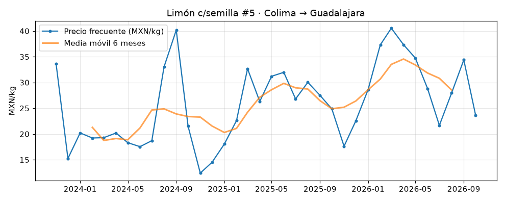
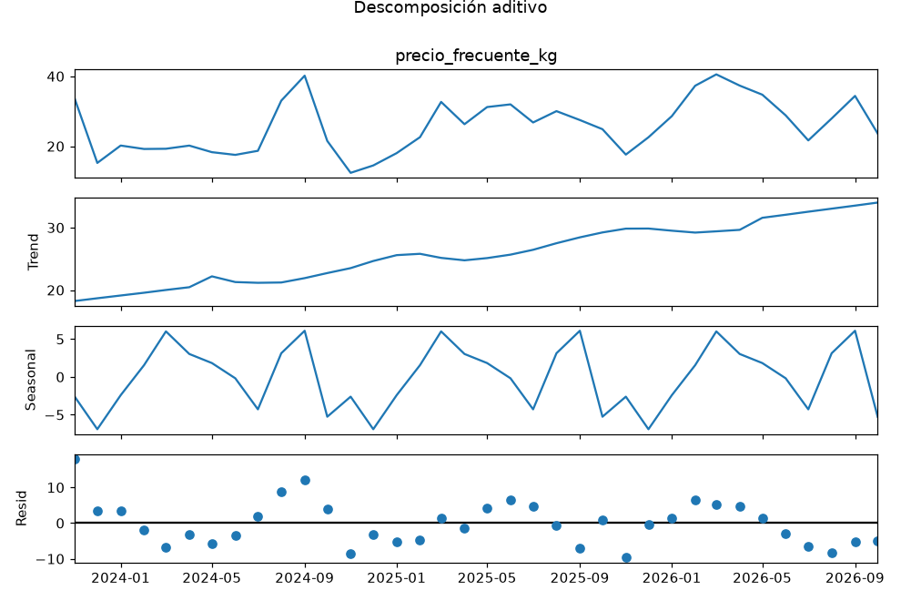
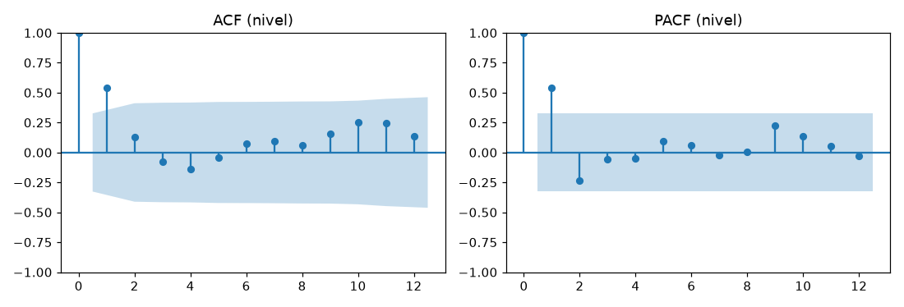

# Laboratorio E1 · Series de tiempo y pronóstico

> Documento **generado** por `python -m laboratorio.e1_series` a partir de `data/oro/panel_mensual.csv`. No editar a mano: las cifras se regeneran. Resultados completos en `laboratorio/resultados/e1/resultados.json`.

**Serie principal:** Limón c/semilla #5 · Colima → Guadalajara, precio frecuente mensual en MXN/kg, 2023-11 a 2026-10 (36 meses, sin imputación). Serie secundaria: Papaya Maradol · Colima → Guadalajara.

## 1. Caracterización

- Nivel: media 25.86 MXN/kg, mediana 25.58, rango 12.40–40.54; coeficiente de variación 29.6 %.
- Tendencia lineal: 0.317 MXN/kg por mes (R² = 0.191, p = 0.0077).
- Estacionalidad: en promedio el mes calendario más caro es el 9 y el más barato el 12 (fuerza estacional 0.32 en escala 0–1).
- Cambio estructural visible: el mayor cambio mensual fue en 2024-08 (76.7 %).
- Ciclos: con 36 meses no se pueden identificar ciclos de más de un año; solo se analiza tendencia y estacionalidad anual.

## 2. Descomposición

Se eligió el modelo **aditivo**. Criterio: preferir el multiplicativo solo si reduce el residuo al menos 5 % o si la dispersión crece claramente con el nivel; si no, el aditivo por parsimonia. El coeficiente de variación del residuo (MXN/kg relativo al nivel) es 0.2347 en el aditivo y 0.2299 en el multiplicativo (mejora 2.0 %); además la correlación entre nivel anual y desviación anual es -0.52 (solo 3 años, evidencia débil).

## 3. Estacionariedad (Dickey-Fuller aumentada y KPSS)

| Serie | ADF | p ADF | KPSS | p KPSS | Conclusión ADF (5 %) |
|---|---|---|---|---|---|
| nivel | -3.6376 | 0.0051 | 0.4481 | 0.0564 | estacionaria |

Orden de diferenciación usado: **d = 0**. KPSS se reporta como contraste (H0 opuesta); su p-valor está acotado entre 0.01 y 0.10 por las tablas de statsmodels.

## 4. Autocorrelación (ACF, PACF) y correlación cruzada

Sobre la serie en nivel (n = 36, banda ±0.327): rezagos significativos en ACF [1] y en PACF [1]. Lectura Box-Jenkins: p ≈ 1, q ≈ 1; la rejilla de AIC explora p, q ∈ {0..3} y un término AR estacional alrededor de esa sugerencia.

- Correlación cruzada (primeras diferencias) con **temperatura media mensual (NOAA, Manzanillo)**: máximo |r| = -0.256 en el rezago 4 (n = 31, banda ±0.352): no significativa al 5 %. Rezago k > 0 significa que la otra variable adelanta al precio del limón en k meses.
- Correlación cruzada (primeras diferencias) con **precio de papaya Maradol (misma plaza)**: máximo |r| = -0.380 en el rezago -4 (n = 35, banda ±0.331): significativa al 5 %. Rezago k > 0 significa que la otra variable adelanta al precio del limón en k meses.

## 5. Cuatro modelos y selección con datos que no vio

Rejilla ARIMA por AIC sobre el entrenamiento (5 mejores):

| orden | estacional | aic | bic |
|---|---|---|---|
| (2, 0, 0) | (0, 0, 0, 0) | 201.59 | 207.19 |
| (0, 0, 1) | (0, 0, 0, 0) | 201.69 | 205.90 |
| (0, 0, 2) | (0, 0, 0, 0) | 202.56 | 208.17 |
| (1, 0, 1) | (0, 0, 0, 0) | 202.64 | 208.25 |
| (2, 0, 1) | (0, 0, 0, 0) | 203.31 | 210.32 |

Entrenamiento: 2023-11–2026-04 (30 meses). Prueba: 2026-05–2026-10 (6 meses, pronóstico a 1–6 pasos sin reentrenar).

| modelo | MAE | RMSE | MAPE_pct | AIC_entrenamiento |
|---|---|---|---|---|
| ARIMA(2, 0, 0) | 4.544 | 5.182 | 14.955 | 201.586 |
| Holt | 5.650 | 6.844 | 22.795 | 211.284 |
| Suavizamiento simple | 8.801 | 10.073 | 34.896 | 208.922 |
| Holt-Winters aditivo | 12.370 | 13.109 | 46.195 | 217.121 |

**Ganador por menor RMSE (desempate MAPE): ARIMA(2, 0, 0).** Se elige por error fuera de muestra, no por complejidad.

Nota: el tablero del observatorio usa además una validación *walk-forward* a un paso (6 meses de selección + 6 de holdout) en `data/oro/metricas_backtest_colima.csv`; ambos procedimientos son complementarios.

## 6. Residuos del modelo ganador (puerta de calidad 3)

- Ljung-Box (rezago 6: Q = 0.91, p = 0.634; rezago 12: Q = 3.73, p = 0.881): sin autocorrelación.
- Varianza: Levene entre mitades p = 0.635, ARCH-LM p = 0.483 → estable.
- Normalidad (Shapiro-Wilk) p = 0.165 → compatible con normal.
- Decisión: se publica el intervalo paramétrico del modelo.

## 7. Pronóstico publicado e interpretación para el cliente

| mes | pronostico | li80 | ls80 | li95 | ls95 | metodo |
|---|---|---|---|---|---|---|
| 2026-11 | 21.18 | 13.57 | 28.78 | 9.55 | 32.80 | paramétrico ARIMA |
| 2026-12 | 23.14 | 13.55 | 32.73 | 8.48 | 37.80 | paramétrico ARIMA |
| 2027-01 | 25.54 | 15.79 | 35.29 | 10.63 | 40.45 | paramétrico ARIMA |

> Para 2026-11 esperamos que el limón c/semilla #5 de Colima se cotice en Guadalajara alrededor de 21.2 MXN/kg; con 80 % de probabilidad estará entre 13.6 y 28.8 y con 95 % entre 9.5 y 32.8 MXN/kg. En los 6 meses de prueba el modelo se equivocó en promedio 4.5 MXN/kg (15 %), así que úselo como rango de referencia para planear, no como precio garantizado.

El pronóstico y su intervalo también se publican en el tablero, en `tablero/laboratorio.html`.

## 8. Serie secundaria: papaya Maradol

d = 0; descomposición multiplicativo; ganador **Holt**; residuos con supuestos no cumplidos (intervalo empírico).

| modelo | MAE | RMSE | MAPE_pct | AIC_entrenamiento |
|---|---|---|---|---|
| Holt | 1.044 | 1.254 | 6.172 | 164.810 |
| Suavizamiento simple | 1.663 | 1.785 | 9.737 | 161.070 |
| Holt-Winters aditivo | 1.605 | 2.038 | 9.438 | 180.309 |
| ARIMA(2, 0, 1) | 2.458 | 2.793 | 14.454 | 151.942 |

> Para 2026-11 esperamos que la papaya Maradol de Colima se cotice en Guadalajara alrededor de 17.7 MXN/kg; con 80 % de probabilidad estará entre 16.0 y 19.3 y con 95 % entre 15.9 y 19.5 MXN/kg. En los 6 meses de prueba el modelo se equivocó en promedio 1.0 MXN/kg (6 %), así que úselo como rango de referencia para planear, no como precio garantizado.

## Limitaciones

- 36 meses permiten estimar estacionalidad anual con solo tres repeticiones por mes; los índices estacionales son inestables.
- La prueba usa 6 meses; un ranking de modelos con tan pocos puntos puede cambiar con la siguiente actualización.
- Los precios son cotizaciones mayoristas SNIIM en plaza, no precio pagado al productor.
