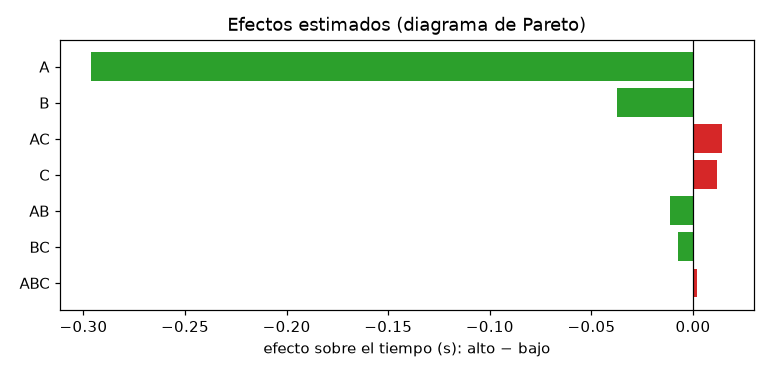
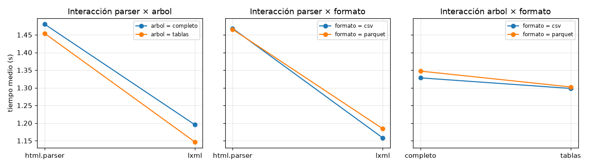
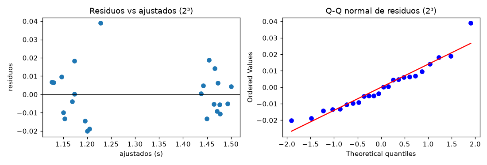
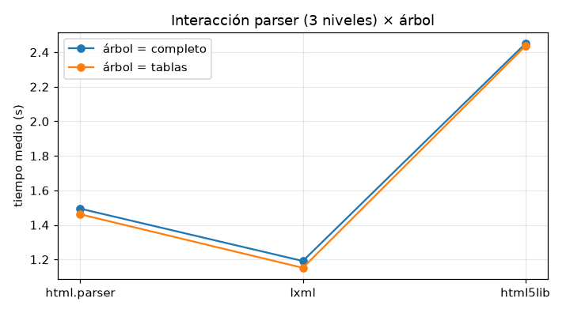

# Laboratorio E2 · Experimento factorial sobre el extractor (ruta ingeniería)

> Documento **generado** por `python -m laboratorio.e2_experimento`. Corridas crudas en `laboratorio/resultados/e2/*.csv`. Se procesan copias locales de la Capa Bronce: el experimento no hace ninguna petición al SNIIM.

## 1. Planteamiento

**Pregunta:** ¿qué combinación de parser HTML, alcance del árbol y formato de salida minimiza el tiempo de procesamiento de las capturas SNIIM sin introducir errores de extracción?

- Unidad experimental: procesar una muestra fija de **150 capturas reales** de Bronce (semilla 20261127), leer, parsear y escribir la salida.
- Respuestas: tiempo (s, medido dentro de un proceso Python aislado, sin contar la importación de librerías) y tasa de error (archivos cuya extracción difiere de la configuración de producción o lanza excepción).
- Entorno: Python 3.12.3, Linux-7.0.0-43-generic-x86_64-with-glibc2.39, 12 CPU lógicas; una sola máquina. Se corrió una configuración de calentamiento antes de medir.
- Fecha de las corridas: 2026-11-27T16:07:01+00:00.

| Factor | Nivel bajo (−1) | Nivel alto (+1) |
|---|---|---|
| A · parser | html.parser | lxml |
| B · arbol | completo | tablas |
| C · formato | csv | parquet |
| D · procesos (solo en 2⁴⁻¹) | 1 | 4 |

**Principios del diseño.** Aleatorización: el orden de los 8 tratamientos se baraja dentro de cada bloque con semilla registrada. Réplicas: 3 por tratamiento. Bloqueo: cada réplica es un bloque que contiene los 8 tratamientos; así la deriva de la máquina (temperatura, carga, caché) entre réplicas se separa del efecto de los factores y se estima como término `bloque` en el ANOVA.

## 2. Diseño 2³ con réplicas y bloques

Corridas en el orden real de ejecución (primeras 8):

| orden | bloque | parser | arbol | formato | tiempo_s | tasa_error |
|---|---|---|---|---|---|---|
| 1 | 1 | lxml | tablas | csv | 1.137 | 0.000 |
| 2 | 1 | html.parser | tablas | parquet | 1.447 | 0.000 |
| 3 | 1 | lxml | tablas | parquet | 1.141 | 0.000 |
| 4 | 1 | html.parser | completo | parquet | 1.467 | 0.000 |
| 5 | 1 | lxml | completo | parquet | 1.186 | 0.000 |
| 6 | 1 | html.parser | tablas | csv | 1.473 | 0.000 |
| 7 | 1 | lxml | completo | csv | 1.192 | 0.000 |
| 8 | 1 | html.parser | completo | csv | 1.462 | 0.000 |

Medias por tratamiento:

| parser | árbol | formato | tiempo_medio_s | de_s | tasa_error | n |
|---|---|---|---|---|---|---|
| html.parser | completo | csv | 1.477 | 0.014 | 0.000 | 3 |
| html.parser | completo | parquet | 1.483 | 0.019 | 0.000 | 3 |
| html.parser | tablas | csv | 1.460 | 0.021 | 0.000 | 3 |
| html.parser | tablas | parquet | 1.448 | 0.011 | 0.000 | 3 |
| lxml | completo | csv | 1.180 | 0.013 | 0.000 | 3 |
| lxml | completo | parquet | 1.211 | 0.048 | 0.000 | 3 |
| lxml | tablas | csv | 1.136 | 0.003 | 0.000 | 3 |
| lxml | tablas | parquet | 1.157 | 0.016 | 0.000 | 3 |

### ANOVA de efectos fijos (modelo con interacciones y bloque)

| Fuente | SC | gl | F | p | eta2_parcial | pct_SC |
|---|---|---|---|---|---|---|
| bloque | 0.0033 | 2.0000 | 5.3033 | 0.0193 | 0.4310 | 0.6100 |
| A | 0.5259 | 1.0000 | 1,677.4940 | 0.0000 | 0.9917 | 96.4673 |
| B | 0.0084 | 1.0000 | 26.7698 | 0.0001 | 0.6566 | 1.5394 |
| A:B | 0.0008 | 1.0000 | 2.4328 | 0.1411 | 0.1480 | 0.1399 |
| C | 0.0008 | 1.0000 | 2.6150 | 0.1282 | 0.1574 | 0.1504 |
| A:C | 0.0012 | 1.0000 | 3.8852 | 0.0688 | 0.2172 | 0.2234 |
| B:C | 0.0003 | 1.0000 | 1.0561 | 0.3215 | 0.0701 | 0.0607 |
| A:B:C | 0.0000 | 1.0000 | 0.0658 | 0.8013 | 0.0047 | 0.0038 |
| Residual | 0.0044 | 14.0000 | — | — | — | 0.8051 |

| efecto | estimacion_s |
|---|---|
| parser | -0.2961 |
| arbol | -0.0374 |
| parser × formato | 0.0142 |
| formato | 0.0117 |
| parser × arbol | -0.0113 |
| arbol × formato | -0.0074 |
| parser × arbol × formato | 0.0019 |

### Supuestos (puerta de calidad 3)

- Normalidad de residuos (Shapiro-Wilk): p = 0.1989 → se cumple.
- Varianza homogénea entre tratamientos (Levene, mediana): p = 0.9139 → se cumple.

### Combinación óptima y corrida de confirmación

Entre los tratamientos con **tasa de error 0**, el de menor tiempo medio es **parser = lxml, arbol = tablas, formato = csv**. El modelo predice 1.136 s (intervalo de predicción 95 % para una corrida: 1.091–1.182 s).

Confirmación: 5 corridas nuevas de la combinación óptima → media 1.161 s (DE 0.026), tasa de error 0.000. La media confirmada **cae dentro** del intervalo de predicción.

**Mejora:** frente a la línea base (html.parser, árbol completo, CSV: 1.477 s) el óptimo reduce el tiempo 21.4 %; frente a la configuración de producción previa al experimento (html.parser, tablas, CSV: 1.460 s) la reducción es 20.5 %.

## 3. Dos factores con tres niveles e interacción (parser × árbol)

Parser con 3 niveles (html.parser, lxml, html5lib) × árbol (completo, tablas), 3 réplicas, orden completamente aleatorizado (18 corridas), formato CSV fijo.

| parser | arbol | tiempo_medio_s | de_s | tasa_error |
|---|---|---|---|---|
| html.parser | completo | 1.494 | 0.022 | 0.000 |
| html.parser | tablas | 1.462 | 0.015 | 0.000 |
| html5lib | completo | 2.450 | 0.018 | 0.000 |
| html5lib | tablas | 2.436 | 0.011 | 0.000 |
| lxml | completo | 1.191 | 0.022 | 0.000 |
| lxml | tablas | 1.152 | 0.006 | 0.000 |

| Fuente | SC | gl | F | p | eta2_parcial | pct_SC |
|---|---|---|---|---|---|---|
| C(parser) | 5.2845 | 2.0000 | 9,686.8433 | 0.0000 | 0.9994 | 99.8587 |
| C(arbol) | 0.0037 | 1.0000 | 13.3877 | 0.0033 | 0.5273 | 0.0690 |
| C(parser):C(arbol) | 0.0006 | 2.0000 | 1.0179 | 0.3905 | 0.1450 | 0.0105 |
| Residual | 0.0033 | 12.0000 | — | — | — | 0.0619 |

Supuestos: Shapiro p = 0.8931, Levene p = 0.9169.

**La interacción no es significativa (p = 0.3905).** El parser domina la variación (p = 0.000000); el ahorro de restringir el árbol a tablas es pequeño (html.parser: 0.033 s; lxml: 0.040 s; html5lib: 0.013 s; efecto principal p = 0.0033). Por construcción html5lib ignora `parse_only`, de modo que en él ese ahorro debería ser nulo; con 3 réplicas la diferencia entre parsers en ese ahorro no es detectable frente al ruido de medición.

Comparaciones múltiples (Tukey HSD, 5 %), solo pares significativos:

| group1 | group2 | meandiff | p-adj | lower | upper | reject |
|---|---|---|---|---|---|---|
| html.parser|completo | html5lib|completo | 0.9553 | 0.0000 | 0.9100 | 1.0006 | True |
| html.parser|completo | html5lib|tablas | 0.9421 | 0.0000 | 0.8968 | 0.9873 | True |
| html.parser|completo | lxml|completo | -0.3031 | 0.0000 | -0.3484 | -0.2578 | True |
| html.parser|completo | lxml|tablas | -0.3427 | 0.0000 | -0.3880 | -0.2974 | True |
| html.parser|tablas | html5lib|completo | 0.9880 | 0.0000 | 0.9427 | 1.0333 | True |
| html.parser|tablas | html5lib|tablas | 0.9747 | 0.0000 | 0.9294 | 1.0200 | True |
| html.parser|tablas | lxml|completo | -0.2705 | 0.0000 | -0.3158 | -0.2252 | True |
| html.parser|tablas | lxml|tablas | -0.3101 | 0.0000 | -0.3553 | -0.2648 | True |
| html5lib|completo | lxml|completo | -1.2585 | 0.0000 | -1.3038 | -1.2132 | True |
| html5lib|completo | lxml|tablas | -1.2980 | 0.0000 | -1.3433 | -1.2527 | True |
| html5lib|tablas | lxml|completo | -1.2452 | 0.0000 | -1.2905 | -1.1999 | True |
| html5lib|tablas | lxml|tablas | -1.2847 | 0.0000 | -1.3300 | -1.2394 | True |

## 4. Diseño completo 2⁴ vs fraccionado 2⁴⁻¹

Cuarto factor D = procesos (1 vs 4 procesos en paralelo).

**2⁴ completo (16 tratamientos por réplica):**

| A | B | C | D |
|---|---|---|---|
| -1 | -1 | -1 | -1 |
| -1 | -1 | -1 | 1 |
| -1 | -1 | 1 | -1 |
| -1 | -1 | 1 | 1 |
| -1 | 1 | -1 | -1 |
| -1 | 1 | -1 | 1 |
| -1 | 1 | 1 | -1 |
| -1 | 1 | 1 | 1 |
| 1 | -1 | -1 | -1 |
| 1 | -1 | -1 | 1 |
| 1 | -1 | 1 | -1 |
| 1 | -1 | 1 | 1 |
| 1 | 1 | -1 | -1 |
| 1 | 1 | -1 | 1 |
| 1 | 1 | 1 | -1 |
| 1 | 1 | 1 | 1 |

**2⁴⁻¹ fraccionado (8 tratamientos por réplica), generador D = ABC, relación definidora I = ABCD (resolución IV):**

| A | B | C | D |
|---|---|---|---|
| -1 | -1 | -1 | -1 |
| -1 | -1 | 1 | 1 |
| -1 | 1 | -1 | 1 |
| -1 | 1 | 1 | -1 |
| 1 | -1 | -1 | 1 |
| 1 | -1 | 1 | -1 |
| 1 | 1 | -1 | -1 |
| 1 | 1 | 1 | 1 |

Estructura de alias (cada efecto se estima sumado a su alias):

| Efecto | Confundido con |
|---|---|
| A | BCD |
| B | ACD |
| C | ABD |
| D | ABC |
| AB | CD |
| AC | BD |
| AD | BC |

Comprobación numérica de los alias en la matriz: True.

Efectos principales quedan confundidos solo con interacciones triples (que se suponen despreciables); las interacciones dobles quedan confundidas entre sí (AB con CD, AC con BD, AD con BC), así que una interacción doble significativa no se puede atribuir sin corridas adicionales (fold-over).

**Ahorro:** por réplica, 8 corridas en lugar de 16 (50 %); con 2 réplicas, 16 en lugar de 32.

Se corrió la fracción con 2 réplicas en orden aleatorio. Efectos estimados (principales y dobles con su alias):

| efecto | estimacion_s | alias (confundido con) |
|---|---|---|
| D | -0.6465 | ABC |
| A | -0.2273 | BCD |
| BC | 0.0646 | AD |
| AD | 0.0646 | BC |
| B | -0.0201 | ACD |
| AB | -0.0155 | CD |
| CD | -0.0155 | AB |
| BD | 0.0115 | AC |
| AC | 0.0115 | BD |
| C | -0.0057 | ABD |

Lectura: el efecto de D (procesos) es -0.647 s: paralelizar con 4 procesos **reduce** el tiempo aun descontando el costo de crear los procesos. Como D está confundido con ABC, el valor supone que la interacción triple es despreciable (en el 2³ completo su efecto fue 0.002 s).

## 5. Conclusión para el observatorio

- Combinación recomendada: **parser = lxml, arbol = tablas, formato = csv**, confirmada con 5 corridas y tasa de error 0.000.
- **Aplicada en producción (E3):** `extractores/sniim_extractor.py::parse_resultados` usa ahora lxml + solo tablas. Antes de adoptarla se corrió el pipeline completo sobre todo Bronce con ambos parsers y las cinco salidas CSV resultaron idénticas (mismo SHA-256); el formato de salida de Plata/Oro sigue en CSV porque Parquet no mostró efecto significativo.
- El experimento es la evidencia de **eficiencia de desempeño** para la evaluación ISO/IEC 25010 (docs/calidad/iso25010.md).
- Alcance: una máquina, una muestra de capturas y un momento; los porcentajes no se extrapolan a otros equipos o volúmenes.
