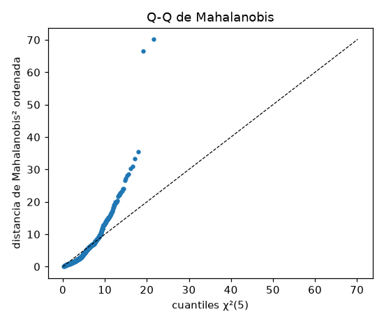
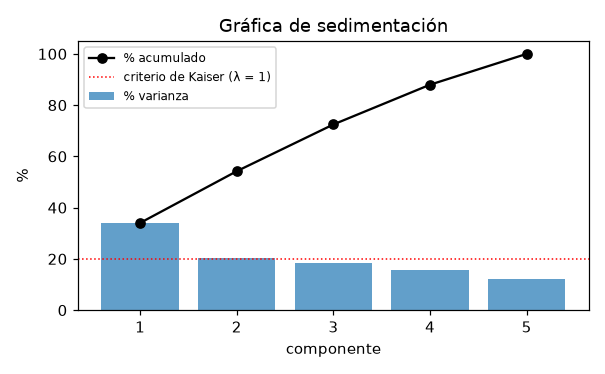

# Laboratorio E3 · Mapa multivariado (normalidad multivariada, PCA y MANOVA)

> Documento **generado** por `python -m laboratorio.e3_multivariado` desde `data/oro/panel_mensual.csv`. Resultados completos en `laboratorio/resultados/e3/resultados.json`; coordenadas del mapa en `laboratorio/resultados/e3/mapa_componentes.csv`.

## 1. Matriz multivariada

Unidad de análisis: una serie de cotización (variante × plaza × origen × presentación) en un mes, con precio convertible a MXN/kg. **n = 825** observaciones completas en 5 grupos (productos): platano 325, limon 216, papaya 144, guayaba 70, tamarindo 70.

| Variable | Definición |
|---|---|
| `log_precio` | log del precio frecuente medio (MXN/kg) |
| `amplitud` | amplitud de cotización (máx − mín) / frecuente |
| `dispersion` | coeficiente de variación del precio frecuente dentro del mes |
| `log_cotizaciones` | log del número de cotizaciones del mes |
| `cambio_mensual` | cambio logarítmico del precio frente al mes anterior de la misma serie |

Se excluyeron precio mínimo y máximo como variables separadas porque son casi colineales con el precio frecuente (correlaciones de 0.949 a 0.996 en Oro) y harían casi singular la matriz de covarianzas; su información entra en `amplitud`.

Vector de medias:

| variable | media |
|---|---|
| log_precio | 2.9491 |
| amplitud | 0.1929 |
| dispersion | 0.0881 |
| log_cotizaciones | 2.9199 |
| cambio_mensual | -0.0028 |

Matriz de covarianzas:

| variable | log_precio | amplitud | dispersion | log_cotizaciones | cambio_mensual |
|---|---|---|---|---|---|
| log_precio | 0.2242 | -0.0096 | -0.0091 | -0.0466 | 0.0244 |
| amplitud | -0.0096 | 0.0304 | 0.0019 | 0.0088 | -0.0038 |
| dispersion | -0.0091 | 0.0019 | 0.0045 | 0.0049 | -0.0005 |
| log_cotizaciones | -0.0466 | 0.0088 | 0.0049 | 0.1082 | -0.0032 |
| cambio_mensual | 0.0244 | -0.0038 | -0.0005 | -0.0032 | 0.0467 |

## 2. Normalidad multivariada

- **Mardia** · asimetría b₁ = 20.217, χ² = 2,779.8 (gl 35), p = 0.0000; curtosis b₂ = 60.32 (esperada 35), z = 43.46, p = 0.0000.
- **Henze-Zirkler** · HZ = 24.909, p = 0.0000.
- Conclusión: **se rechaza** la normalidad multivariada al 5 %.

La gráfica Q-Q compara las distancias de Mahalanobis² con los cuantiles χ²; los puntos que se alejan arriba a la derecha son meses-serie atípicos (colas más pesadas que la normal).

## 3. Componentes principales

Las variables tienen escalas distintas (logaritmos, proporciones, cambios), por eso el PCA se hace sobre la **matriz de correlaciones** (variables estandarizadas).

| componente | valor propio | % varianza | % acumulado |
|---|---|---|---|
| CP1 | 1.702 | 34.036 | 34.036 |
| CP2 | 1.009 | 20.184 | 54.220 |
| CP3 | 0.912 | 18.237 | 72.457 |
| CP4 | 0.776 | 15.514 | 87.971 |
| CP5 | 0.601 | 12.029 | 100.000 |

Criterio de Kaiser: 2 componentes con valor propio > 1; los dos primeros explican 54.2 % de la varianza.

Cargas (correlación variable–componente):

| variable | CP1 | CP2 | CP3 |
|---|---|---|---|
| log_precio | 0.735 | 0.162 | 0.335 |
| amplitud | -0.460 | 0.048 | 0.874 |
| dispersion | -0.627 | 0.371 | -0.088 |
| log_cotizaciones | -0.638 | 0.311 | -0.167 |
| cambio_mensual | 0.386 | 0.864 | -0.014 |

Nombres de negocio de los componentes (derivados de las cargas con |carga| ≥ 0.5):

- **CP1** · Índice de nicho: precio alto en un mercado delgado y estable
- **CP2** · Índice de impulso: alza del precio frente al mes anterior
- **CP3** · Índice de margen de negociación: distancia entre cotización máxima y mínima

## 4. El mapa: interpretación para el cliente

Centroides de cada producto en el plano CP1–CP2:

| producto | CP1 | CP2 |
|---|---|---|
| platano | -0.256 | -0.022 |
| limon | -0.666 | 0.170 |
| papaya | 0.193 | 0.015 |
| guayaba | 0.923 | -0.231 |
| tamarindo | 1.926 | -0.219 |

- En **CP1** (índice de nicho: precio alto en un mercado delgado y estable), el producto más alto es **tamarindo** (1.93) y el más bajo **limon** (-0.67).
- En **CP2** (índice de impulso: alza del precio frente al mes anterior), el producto más alto es **limon** (0.17) y el más bajo **guayaba** (-0.23).

Lectura para el comprador: productos cercanos en el mapa se comportan parecido en precio, estabilidad y profundidad de mercado, así que pueden gestionarse con la misma estrategia de compra; los alejados requieren reglas distintas (por ejemplo, contratos a precio fijo para los de mayor volatilidad). El mapa se publica en `tablero/laboratorio.html`.

## 5. MANOVA: ¿los productos difieren en las cinco variables a la vez?

Supuesto de homogeneidad de matrices de covarianza (M de Box): χ² = 1,167.1, gl = 60, p = 0.0000 → **no homogéneas**.

| Estadístico | Valor | F aprox. | gl num | gl den | p |
|---|---|---|---|---|---|
| Wilks' lambda | 0.4130 | 41.37 | 20 | 2,707.3 | 0.000000 |
| Pillai's trace | 0.7098 | 35.34 | 20 | 3,276.0 | 0.000000 |
| Hotelling-Lawley trace | 1.1402 | 46.46 | 20 | 1,787.8 | 0.000000 |
| Roy's greatest root | 0.8496 | 139.16 | 5 | 819.0 | 0.000000 |

Prueba de permutación de la traza de Pillai (999 permutaciones, semilla fija): Pillai = 0.7098, p = 0.0010.

**Puerta de calidad 3.** Como la normalidad multivariada y/o la homogeneidad de covarianzas no se cumplen, la conclusión se basa en la **traza de Pillai** (la más robusta a esas violaciones) y se confirma con la **prueba de permutación**, que no depende de la normalidad. Lambda de Wilks se reporta, pero no se usa como evidencia principal. Conclusión: los cinco productos **sí difieren** en el vector de variables al 5 %.

### ¿Por qué no basta con cinco ANOVA separados?

| variable | F | p | p_bonferroni |
|---|---|---|---|
| log_precio | 118.741327 | 0.000000 | 0.000000 |
| amplitud | 31.463069 | 0.000000 | 0.000000 |
| dispersion | 21.057628 | 0.000000 | 0.000000 |
| log_cotizaciones | 70.207808 | 0.000000 | 0.000000 |
| cambio_mensual | 0.360266 | 0.836942 | 1.000000 |

- Correr 5 ANOVA al 5 % cada uno eleva la probabilidad de al menos un falso positivo a 1 − 0.95⁵ = 22.6 % si no se corrige.
- Los ANOVA separados ignoran las correlaciones entre variables (la más fuerte aquí es log_precio con log_cotizaciones, r = -0.30); la MANOVA usa la matriz de covarianzas completa y puede detectar diferencias en combinaciones de variables que ninguna variable muestra por sí sola.
- Por eso la MANOVA es la prueba global; los ANOVA con corrección de Bonferroni solo indican qué variables contribuyen.

## Limitaciones

- Las observaciones de una misma serie en meses consecutivos no son independientes; la permutación a nivel de mes-serie no corrige esa dependencia, así que los p-valores son optimistas.
- Los grupos tienen tamaños distintos y mezclan plazas y orígenes; un diseño con plaza como segundo factor requeriría más series pareadas.
